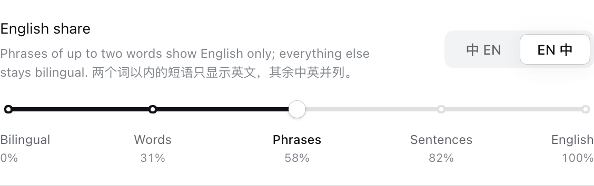
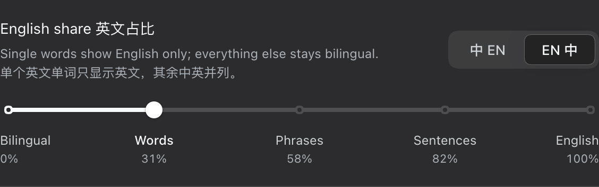

# dsh-bilingual-i18n —— DeepSeek Harness 中英双语界面

**设置 → 通用 → 英文占比**：一个 5 档滑块，最左中英双语，最右纯英文。
越往右，只显示英文的文案越多。切换顺序按英文的长短来：先是单个单词，再是短语、
短句，最后整句都只剩英文。长句保留中文对照的时间最长。




## 5 个档位

| 档 | 名称 | 只显示英文的文案 | 例 | 纯英文占比* |
|---|---|---|---|---|
| 1（最左） | 双语 | 无，全部中英并列 | `取消 Cancel` · `新建会话 New session` | 0% |
| 2 | 单词 | 英文 ≤ 1 个词 | `Cancel` · `新建会话 New session` | ≈ 30% |
| 3 | 短语 | 英文 ≤ 2 个词 | `New session` · `停止并归档此会话？ Stop and archive this session?` | ≈ 57% |
| 4 | 短句 | 英文 ≤ 5 个词 | `Stop and archive this session?` · 长句仍中英并列 | ≈ 80% |
| 5（最右） | 英文 | 全部 | 直接切到内置 English | 100% |

\* 按 DSH 0.2.1 内置词典实测。滑块下方显示的是**你当前装的插件**的实际占比，会随插件不同略有出入。

- 词数不计 `{name}` 这类占位符和标点。
- 第 1–4 档并列时可以选 **中文在前 / 英文在前**（滑块行右上角的 `中 EN | EN 中`）。
- 语言下拉里只多一项 **中英双语 · Bilingual**。选它就用滑块记住的档位，选 English 就是第 5 档。
  选「中文」时滑块不落在任何档位，点任一档即可切回中英混合。

## 原理

插件不带文案表。它读取 DSH 运行时里已经注册好的 zh / en 词典，给每个命名空间注册一个
「中英双语」词典。这个词典是 Proxy，取词时按当前档位现算，所以：

- 拖动滑块会立刻重新渲染，不用刷新页面；
- 之后才加载的第三方插件词典也会自动纳入；
- 插件卸载或重新加载时，注册会完整撤销、重来。

有些条目不能并列，比如 `zh-CN`/`en` 这样的语言代码（会传给日期格式化）、URL、分隔符
`、`/`, `、单位 `秒`/`s`，以及首尾带空格、要拼进别的句子的片段。这类条目只能整体二选一：
第 1 档用中文，到它词数对应的档位整体换成英文。否则会出现 `zh-CN en`、`3分 m`、
`， , ` 这样的坏值。多行文案（Markdown）按段落拼接，标题仍在行首。

## 安装

### 桌面版

桌面 profile 由 Electron 独占，`dsh plugin` 命令装不了。编辑
`~/.dsh/profiles/desktop/package.json`：依赖里加上 `dsh-bilingual-i18n`，
`dsh.profile.bundles` 里加上包名（只有进 bundles 才会激活）：

```json
{
  "dependencies": { "dsh-bilingual-i18n": "^0.2.0" },
  "dsh": {
    "profile": {
      "bundles": ["@deepseek-ai/dsh-base", "@deepseek-ai/dsh-web-app", "dsh-bilingual-i18n"]
    }
  }
}
```

然后用 **DSH 自带的 pnpm** 安装（系统里的 pnpm 版本不同，会改写 profile 的锁文件）：

```bash
cd ~/.dsh/profiles/desktop
node "$DSH_APP/Contents/Resources/runtime/primary-runtime/dependencies/pnpm/bin/pnpm.mjs" install --ignore-scripts
```

重启 App，然后打开 **设置 → 通用 → 英文占比**。

### Web 版（`dsh web`）

```bash
dsh plugin --profile web add dsh-bilingual-i18n
dsh --profile web --port 8080
```

这条命令会同时写入依赖和 `dsh.profile.bundles`。

### 从源码装（开发用）

把上面的 `dsh-bilingual-i18n` 换成软链到本仓库即可，改代码后重启 App 即生效：

```json
"dependencies": { "dsh-bilingual-i18n": "link:/绝对路径/dsh-bilingual-i18n" }
```

Web 版同理：`dsh plugin --profile web add link:/绝对路径/dsh-bilingual-i18n`。

## 偏好保存在哪

档位和语序跟其它「通用」设置一样，经 DSH 设置服务写进 profile 的 `cordis.patch.yml`，
换浏览器也在。也可以手改：

```yaml
- id: dsh-bilingual-i18n
  config:
    level: 3          # 1 双语 · 2 单词 · 3 短语 · 4 短句
    order: zh-first   # zh-first 中文在前 · en-first 英文在前
```

第 5 档就是语言偏好 `locale.preference: en`，不占 `level`。
浏览器本地另存一份副本（`localStorage` 的 `dsh-bilingual-i18n:prefs`），用于启动时立即生效。
运行中的 DSH 不提供设置服务时，就只用这份本地副本。

卸载：从 `package.json` 的 bundles 和依赖里删掉 `dsh-bilingual-i18n`，再用上面那个 DSH 自带的 pnpm
执行一次 `install --ignore-scripts`，然后重启 App。

## 开发

```bash
npm test            # 自测（98 项）
npm run calibrate   # 用本机 DSH 的真实词典标定各档占比、列出原子条目
npm install         # 首次：装 playwright-core，只给端到端测试用
npm run e2e         # 隔离的 dsh web + 无头 Chrome，在真实界面里走一遍，截图在 .e2e/shots/
```

`npm test` 分五组：

1. 合成规则：5 档阈值与单调性、原子条目、占位符、多行文案、语序。
2. 偏好：本地副本，以及 Host 配置的采用、迁移、写入合并和只读场景。
3. 设置行：用最小的假 React 渲染，检查刻度、滑块值和回调。
4. 宿主半侧：用运行时自带的 schemastery 校验 `Config` 的默认值、取值范围和 volatile 标记。
5. 集成：从本机 `app.asar` 抽出真实的 locale 运行时和全部内置客户端插件，注册真实词典后
   运行本插件。逐档核对每一条取词结果，并检查语言代码与 URL 在每档都合法、占位符不丢、
   第 5 档的预览与延迟切换、之后才注册的命名空间、卸载清理和重复加载。

第 4 组的校验、第 5 组和两个脚本都需要本机装有 DeepSeek Harness，找不到 `app.asar` 时跳过
（可用 `DSH_APP_ASAR` 指定路径）。

代码结构、改动前必须守住的不变量和踩坑速查见 [AGENTS.md](AGENTS.md)；
为什么这么设计见 [docs/开发记录.md](docs/开发记录.md)；
DSH 客户端机制的源码级笔记见 [docs/DSH客户端机制调研.md](docs/DSH客户端机制调研.md)。

## 已知限制

- 读取内置词典依赖运行时的内部字段 `ctx.locale.dicts`。如果将来改名，插件不注册
  「中英双语」，滑块行会提示不可用，其余功能不受影响。
- 由几个词条拼起来的句子（如自动化任务的「每周一、三 09:00」）在并列档位里可能中英混杂，
  因为被填进去的词本身也是按档位合成的。
- 注册时就取好文案、不走插槽渲染的地方（DSH 自身的限制，如部分命令说明）不会随滑块实时
  更新，刷新页面后生效。
- 插件市场里插件的标题和简介不走词典，中英双语下显示中文。
- 并列的文案更长，窄侧边栏里可能被截断。
- 桌面 App 的原生菜单只有中、英两套。选中英双语时，原生菜单跟随系统语言。

## 许可

MIT
